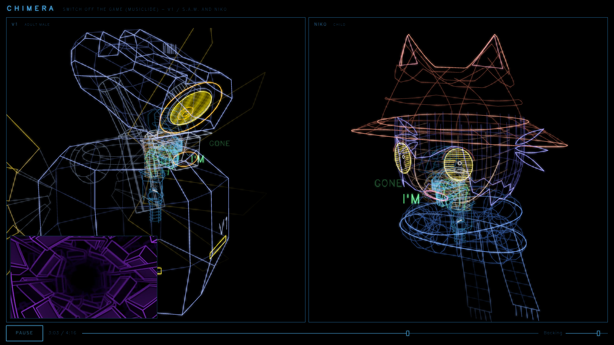
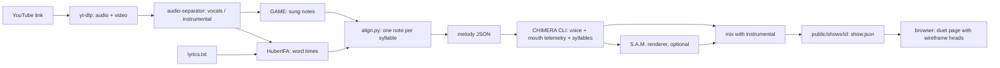

# Song covers with CHIMERA

This folder adds a song-cover workflow to CHIMERA. You give it a YouTube link. You get a "duet
show": the song plays in the browser while two 3D wireframe heads sing it, with mouths that move in
time with the voice and the original video in a corner.

We used it to make three covers:

| Show | Song | Voices | Heads |
|---|---|---|---|
| `switch-off` | Musiclide, "Switch Off The Game" | CHIMERA sings both parts | CHIMERA's own head (the World Machine) and Niko (OneShot) |
| `artist-block` | St4tic, "ARTIST BLOCK" | The S.A.M. UTAU voicebank sings, S.A.M. text-to-speech speaks | One V1 head (ULTRAKILL) per role |
| `switch-off-v1` | Musiclide, "Switch Off The Game" | S.A.M. sings the World Machine's part, CHIMERA sings Niko | V1 and Niko |



## How it works



## Read in this order

1. [Setup](docs/setup.md): tools, models, and the folder layout.
2. [From a YouTube link to a show](docs/song-from-youtube.md): download, stems, notes, words,
   melody files, CHIMERA render, mix.
3. [Singing with S.A.M.](docs/sam-singing.md): the UTAU bank renderer, spoken lines, pitch choices.
4. [Wireframe heads](docs/wireframe-heads.md): the costume API and how we modeled Niko and V1
   from reference models.
5. [UI changes](docs/ui-changes.md): what we changed in the web app, and the `show.json` format.
6. [Record and host](docs/record-and-host.md): screenshots, mp4 recording, static hosting.

## Folder layout

```
covers/
  paths.py        where scripts find WORK and VENDOR
  song/           YouTube to melody files, CHIMERA show build (build_show.sh)
  sam/            S.A.M. UTAU renderer and the S.A.M. show builds
  heads/          reference-model measuring scripts (Niko, V1)
  show/           screenshot and mp4 recording tools
  docs/           the guides above
  img/            screenshots for the docs
  work/           (gitignored) song data and renders
  vendor/         (gitignored) outside tools, models and the voicebank
```

## What is not in this repo

No song audio, video, voicebank, or game and fan 3D models are in this repo. We do not have the
rights to share them. The docs tell you where to get each one. Shows go to `public/shows/<id>/`,
which upstream CHIMERA also keeps out of git.

The wireframe heads in `src/ui/render/niko.ts` and `src/ui/render/v1.ts` are fan art of
characters from OneShot and ULTRAKILL. We drew them by hand in code, with sizes measured from
fan-made reference models.
