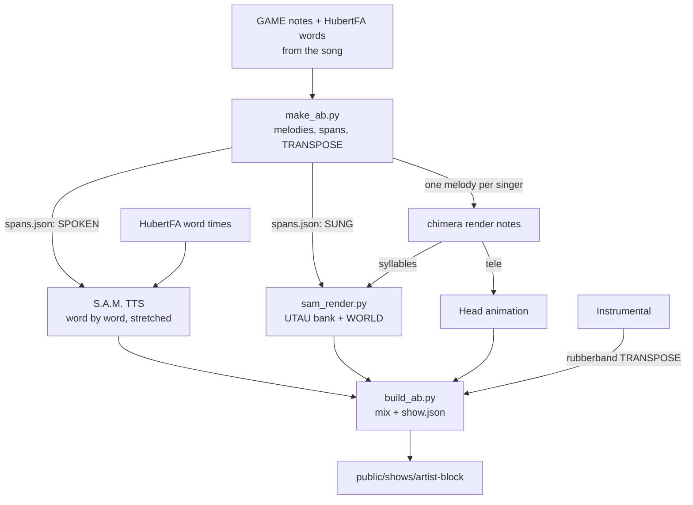

# S.A.M. singing: a speech-synth voice on a CHIMERA song

This page shows how we made CHIMERA's heads move while a different voice sings. The voice is **S.A.M.**, played through a UTAU voicebank. CHIMERA does not make the sound. It only makes the mouth movement.

We built two shows this way:

| Show | What it is |
|------|------------|
| `artist-block` | St4tic "ARTIST BLOCK". Seven roles, one head per role: V1 plays Caine, the six guests keep CHIMERA's own head. S.A.M. sings and speaks every role. |
| `switch-off-v1` | The "Switch Off The Game" cover, but V1 (S.A.M.) sings the World Machine part. Niko stays CHIMERA's own child voice. |

Run all commands from the repo root. Setup of the tools is in [setup.md](setup.md). How the song data (stems, notes, words) is made is in [song-from-youtube.md](song-from-youtube.md). How the V1 and Niko heads look is in [wireframe-heads.md](wireframe-heads.md).

## What S.A.M. is

S.A.M. here means **Software Automatic Mouth**. It is a speech program from 1982 (Don't Ask Software). It is the robot voice that ULTRAKILL fans use for V1.

It is **not** Microsoft Sam. Microsoft Sam is a different voice with different voicebanks. We checked this in the bank files: the bank we use is the "S.A.M." UTAU port of Software Automatic Mouth. The `character.txt` in its VCV folder names MiningSquirrel as the author.

We use two things from S.A.M.:

1. **A UTAU voicebank** for singing (the "Samparsing" ARPAsing English bank).
2. **The S.A.M. text-to-speech program** for the spoken lines.

Both give the same robot character, so the singing and the speech sound like one person.

## Get the voicebank

The bank is in the "Samouthuel" pack, file `Samouthuel.rar`. The pack lists "VCV Japanese, Arpasing English and CV-V Chinese" in one download. Find the link on the FUSEloids page (https://f2seloids.carrd.co/#sam-tts). The pack is by MiningSquirrel; the page credits TeionLeeIRL as the provider.

Do not put the bank in a public repo. The repo ignores `covers/vendor/`, so keep it there.

Unpack the RAR with 7-Zip. Use the standalone `7zz` (or `7z`) binary:

```bash
mkdir -p covers/vendor/sam-bank-pack
7zz x Samouthuel.rar -ocovers/vendor/sam-bank-pack
```

The pack has three folders: S.A.M. VCV (Japanese), S.A.M. Arpasing (English) and S.A.M. Chinese. We only need the English one, in a folder called `Samparsing`. Link it as `covers/vendor/sam-bank`:

```bash
ln -s "$(pwd)/covers/vendor/sam-bank-pack/Samparsing" covers/vendor/sam-bank
ls covers/vendor/sam-bank
```

The `ls` must show `G#2 BASE`, `G#2 Extras` and `prefix.map`. (The folder name inside your unpacked pack may differ a little. Link the folder that holds those two sub-folders.)

You can use another place with the `SAM_BANK` environment variable. It wins over the default.

What is in the bank (we measured it):

- `G#2 BASE`: 139 wav files, 1432 `oto.ini` lines. 44.1 kHz, mono, 16 bit.
- `G#2 Extras`: 18 files with fade-out endings for vowels and nasals. The renderer reads Extras last, so these endings replace the BASE ones.
- `prefix.map` sends every pitch to one suffix, `G#2`. The renderer removes that suffix from each alias.
- `oto.ini` files are in Shift-JIS (cp932).
- Each alias is a diphone in ARPAbet, like `- t` (start of a phrase), `ae p` (from one sound to the next) and `ow -` (ending). The five diphthongs (`ay ey ow aw oy`) are single sounds.
- The bank was recorded at one pitch, about 104 Hz (G#2). Some files sit an octave up, about 213 Hz.

## S.A.M. text-to-speech

Build the S.A.M. C port from source. We cloned https://github.com/vidarh/SAM (a fork of https://github.com/s-macke/SAM). The Makefile uses SDL by default. We do not need SDL, because we only write wav files. Change two lines:

```bash
git clone https://github.com/vidarh/SAM covers/vendor/sam-tts
sed -i 's/^CFLAGS =.*/CFLAGS = -Wall -O2/; s/^LFLAGS =.*/LFLAGS =/' covers/vendor/sam-tts/Makefile
make -C covers/vendor/sam-tts
covers/vendor/sam-tts/sam -wav /tmp/sam-test.wav HELLO WORLD
```

The program writes a 22.05 kHz, 8-bit mono wav. Use upper-case text.

## Pipeline overview



In short:

1. `make_ab.py` turns the song data into two CHIMERA melody files and a list of sung and spoken spans.
2. CHIMERA renders each melody. We keep its **telemetry** (mouth shapes for the heads) and its **syllables**. We throw its sound away.
3. `sam_render.py` sings those syllables on the same beats with the S.A.M. bank. Because the beats are the same, the lips on screen match the sound.
4. Spoken lines come from S.A.M. TTS. They are placed word by word on the original word times.
5. `build_ab.py` mixes everything and writes the show.

## `sam_render.py`: the singer

```bash
.venv/bin/python covers/sam/sam_render.py NOTES.json OUT.wav --bpm 120
```

`NOTES.json` is the syllable file that `chimera render notes ... --syllables` writes. It is a list of `{t, dur, midi, syl: {text, onset, nucleus, coda, melisma?, phraseEnd?}}`. Times are in seconds. `--timing` writes a timing file (default `OUT.timing.json`). `--bpm` only sets the length of one consonant.

There is no headless UTAU or OpenUtau renderer, so we wrote our own. It follows the OpenUtau "ARPAsing" layout and the UTAU `oto` rules (offset, consonant, cutoff, preutterance, overlap). It joins the sounds in the WORLD parameter domain, not as raw waveform. This gives no clicks.

Steps inside the renderer:

1. **IPA to ARPAbet.** CHIMERA's syllabifier gives IPA. The `IPA` table at the top of the file maps each symbol to a bank phone. An unknown symbol stops the run with its name. Add it to the table.
2. **Layout.** The vowel starts on the note start. Onset consonants go before it, 62.5 ms each at 120 BPM. Coda consonants go at the note end. A melisma note extends the vowel of the syllable before it. A phrase ends on `phraseEnd`, or when the next note starts more than 0.12 s later. At a phrase end the renderer adds a `x -` ending.
3. **Alias choice.** For each pair it picks `prev cur`. If the bank has no such diphone it tries vowel fallbacks, then restarts with `- cur`. The bank has no diphone for most consonant pairs, so many restarts happen. About 15% of phones did in our test.
4. **WORLD analysis.** Each bank wav is analysed once with WORLD (`harvest` for pitch, `cheaptrick` for the spectrum, `d4c` for aperiodicity). The result is cached in `covers/work/sam-cache/` (about 250 MB). The first run is slow. Later runs are fast. We use `harvest`, not `dio`, because some bank vowels sit an octave up and `dio` calls them unvoiced.
5. **Pitch.** The renderer ignores the pitch in the bank. It draws one flat pitch per note, with a 40 ms glide between notes. There is no vibrato. This flat pitch is the "robot" sound. [INFERENCE: we believe it matches the S.A.M. character. We could not check against a reference by ear.]
6. **Timing.** Sounds are compressed at most 2x or stretched by playing the last 80 ms back and forth. Notes come from CHIMERA, so the timing is the CHIMERA timing.
7. **Synthesis.** Parameters of all sounds in a phrase are blended and WORLD makes the sound. The output is peak-normalised to 0.9, 44.1 kHz, mono.

Two fixes we needed:

- Pitch tracking dropped the voice for about 100 ms inside some diphthong-to-nasal glides. `bridge()` fills gaps of up to 125 ms when the sound is clearly voiced.
- Zero-power frames make WORLD output NaN. The renderer floors the spectrum at `1e-16`.

Known limits: stop consonants are a little softer than in UTAU, long vowels are static, and the level of each diphone is not equalised.

## `make_ab.py`: melodies and spans (ARTIST BLOCK)

```bash
.venv/bin/python covers/sam/make_ab.py --show
```

Inputs (all under `covers/work/ab/`, made as in [song-from-youtube.md](song-from-youtube.md)):

| File | Content |
|------|---------|
| `song/game/vocals.txt` | GAME note transcription of the vocal stem |
| `song/aligned_words.json` | HubertFA word times, with a `line` number for each word |
| `song/lines_timed.json` | each lyric line: start, end, singer, `kind` (`SUNG` or `SPOKEN`), text |
| `research/f0_rmvpe.npy` | RMVPE pitch of the vocal stem (made on the first run, see `rmvpe_hz()` in `covers/song/cover.py`) |

It uses `covers/song/align.py` to match syllables to GAME notes. It writes `build/<singer>.json` (Caine, Pomni, Jax, …) and `build/spans.json`. The `--show` flag prints each line's notes.

What it does:

- **One voice per singer.** Each role in `lines_timed.json` (`who`, from Genius' singer headers) gets its own melody and its own head. A line that "All six" sing goes to each of the six. A line "Ragatha + others" goes to Ragatha.
- **Sung or spoken.** Each line has a `kind` in `lines_timed.json`. We typed it from context and from the audio, because GAME also "finds" notes in speech. Spoken lines still get notes, so the head moves, but the sound comes from TTS.
- **Pitch fix for sung lines.** The singers are human and parts are rapped, so GAME wanders. A sung note's pitch is the median RMVPE pitch in the first 0.3 s of the note (pYIN, used before, had no pitch for most held notes: at 2:18-2:21 it held 0.5 s of 3.5). It is moved by whole octaves next to the median of its line. Then it is snapped to the key. The key is E flat minor, and E minor from `OUTRO = 202` s on.
- **Octave fitting.** Each sung line moves by whole octaves so its median is nearest `CENTER` (MIDI 57). Female roles end up an octave down.
- **`TRANSPOSE = -7`.** After that, the whole song moves 7 semitones down (to A flat minor). Caine ends up at about 156 Hz. `build_ab.py` moves the instrumental by the same amount.
- **`HAND` lines.** Some lines have no usable GAME or pYIN notes: the laughs, "Oh.", and the bridge where six voices sing at once. We set them by hand as `(start, length, note, word)`. The bridge notes follow the few pitches pYIN did hold. [They are a guess, not a transcription.]
- **Word and note counts.** `fit()` asks CHIMERA how many syllables it makes of each word. Extra notes become melisma. A missing note splits the last note.
- **Overlaps.** When two lines run into each other, the earlier note gives way.

`spans.json` is a list of `{voice, kind, line, who, text, start, end}` in seconds. `build_ab.py` reads it.

## `build_ab.py`: mix and show

```bash
.venv/bin/python covers/sam/build_ab.py
```

It takes one to two minutes. It needs the CHIMERA CLI built (`./target/release/chimera`). Steps:

1. Runs `make_ab.py`.
2. Runs `chimera render notes` for both voices. It keeps `--tele` (the head animation) in the show folder and `--syllables` in the build folder.
3. **Sung parts.** It selects the syllables that start inside a `SUNG` span and renders them with `sam_render.py` at 120 BPM.
4. **Spoken parts.** For each `SPOKEN` span it takes the words of that line from `aligned_words.json`. For each word it:
   - runs `covers/vendor/sam-tts/sam -wav` on the word alone,
   - removes silence,
   - stretches the word to the length of the original word (HubertFA times) with ffmpeg `atempo`, at most 2.5x faster and at most 1.25x slower (stretched further, S.A.M.'s voice turns into a loud buzz: a word given more time ends early instead),
   - and puts it at the original word start, with a 5 ms fade.

   This keeps the actors' pace and pauses. A line without aligned words, or a `HAND` line, is spoken whole over the line span (so the voice and the head's mouth agree). Text in brackets is dropped and characters S.A.M. cannot say are removed. Spoken words get 0.8 gain.
5. **Instrumental.** It moves the official instrumental by `TRANSPOSE` with ffmpeg `rubberband` (needs an ffmpeg with librubberband). The result is cached as `build/instrumental-7.wav`. Delete it to rebuild.
6. **Balance.** It measures the RMS of the original vocal stem and instrumental. It sets the voices against the backing at the same ratio, plus `LIFT_DB = 2.0`. S.A.M. sits under the band more than a human voice does, so it needs a bit more level. Change `LIFT_DB` for a new song if the voice is buried or too loud.
7. **Mix.** The singers are panned apart, from 0.3 left to 0.3 right. A line several heads sing (the bridge) sounds once, from its first singer; the other heads mime it (S.A.M. has one voice, so six equal copies would only be louder). The page plays voices and backing at full volume together, so a scale factor `k` keeps the sum below 0.95. It writes `mix.mp3` (voices only) and `backing.mp3`.
8. **Show.** It copies the melodies and `video.mp4` and writes `show.json` with one head per singer. Caine's head wears the V1 look (`"look": "v1"`); the guests keep CHIMERA's own head. A guest's head is on screen only while it sings (`on`: 0.3 s before each of its lines to 0.3 s after, breaks under 4 s joined). Each file name carries a `?v=` hash so caches never serve old files.

Result: `public/shows/artist-block/`. Open `http://127.0.0.1:5317/?show=artist-block` with the dev server running (see [setup.md](setup.md) and [record-and-host.md](record-and-host.md)).

Knobs for a new song:

| Knob | File | Meaning |
|------|------|---------|
| `TRANSPOSE` | `make_ab.py` | Whole-song shift in semitones |
| `CENTER` | `make_ab.py` | Target octave of the sung lines (MIDI) |
| `OUTRO` | `make_ab.py` | Time of a key change, if any |
| `MINOR` and the tonic in `refine()` | `make_ab.py` | Key used to snap notes |
| `HAND` | `make_ab.py` | Lines set by hand |
| `align.BPM`, `align.T0` | `make_ab.py` | Tempo and first beat of the song |
| `LIFT_DB` | `build_ab.py` | Voice level against the band |
| the `-0.3 … 0.3` pans | `build_ab.py` | Left/right place of each singer |
| the bpm and `downbeat` in `show` | `build_ab.py` | What the page uses for its clock |

## `build_switch_v1.py`: reuse a CHIMERA song

```bash
.venv/bin/python covers/sam/build_switch_v1.py
```

This is the short path. It needs no new analysis. The song already exists as CHIMERA melodies made by `covers/song/make_song.py` (see [song-from-youtube.md](song-from-youtube.md)) in `covers/work/song/{lead,second}.json`. The script:

1. Shifts the lead melody by `V1_SHIFT = -12` (one octave down) and keeps the second melody as it is.
2. Renders the lead with CHIMERA as a male voice for the head (`--tele` and `--syllables`). It renders the second melody as the child voice (Niko).
3. Sends the lead syllables to `sam_render.py` at 96 BPM.
4. Sets Niko's level to `NIKO = 1.1` times the active RMS of S.A.M. (RMS over the frames that are not silent).
5. Mixes with the separated "other" stem as the backing, at the original vocal-to-backing balance plus `LIFT_DB = 2.0`.
6. Writes `public/shows/switch-off-v1/`. The video is copied from the `switch-off` show. Niko enters at 179 s.

Only the V1 part changes. The song and Niko keep their original pitch. That is why this show uses an octave shift and not a whole-song transpose.

## `measure.py`: quality check

```bash
.venv/bin/python covers/sam/measure.py OUT.wav OUT.timing.json
```

It runs WORLD `harvest` on the output and compares each note with its target pitch inside the vowel. It prints:

- the median pitch error per note, in cents (we flag more than 25),
- silent gaps of 30 ms or more, next to the gaps the timing file declares as rests,
- click candidates (a spike in the second difference).

On our test files, all notes were within 7 cents, the median error over 344 notes was 0.3 cents, and the click count was 0. This shows the renderer hits the requested pitch. It does not say how the voice sounds. Listen to the result.

## Pitch lessons

The bank has one fixed character. You cannot move the voice far without it falling out of tune with the song.

- **Only octave steps or a whole-song transpose keep the voice in key.** If you move one voice by a fifth and the music stays, the melody no longer fits the chords. So either move a line by 12 semitones, or move the instrumental by the same amount (we used rubberband).
- **S.A.M. talks near 121 Hz.** Notes much below that sound muddy. Notes far above about 200 Hz sound thin and shrill.
- **About 140 to 160 Hz worked.** In ARTIST BLOCK, Caine's original range (about A sharp 3, 233 Hz) was too high. One octave down (117 Hz) was too low. A fifth down for the whole song put Caine at about 156 Hz. That is why `TRANSPOSE = -7`.
- **Switch Off.** The World Machine part sits at about A sharp 3. An octave down is about 117 Hz. It is in key and it works, but it is low. We chose it because Niko and the instrumental stay unchanged.
- **For a new song:** find the median pitch of the part, then pick the octave shift that brings it nearest 140 to 160 Hz. If no octave shift fits, transpose the whole song and the instrumental.

## Pitfalls we hit

- `pyworld` needs `pkg_resources`. With a new `setuptools` it fails to import. Use `setuptools<81`.
- GAME finds notes in speech and rap. A "sung" line can have wild pitches. Fix them by octave and key (`refine()`), or write them by hand (`HAND`).
- GAME and pYIN fail in a six-voice bridge. We used a plain rhythm and the few pitches pYIN held.
- A word that S.A.M. says in 0.2 s but the actor said in 0.1 s would need a 2x squeeze. We cap at 2.5x. A harder squeeze only makes the word run a little long.
- The S.A.M. TTS wav is 8-bit. It has a DC offset, so `build_ab.py` removes the median before trimming silence.
- Old build caches: delete `covers/work/ab/build/instrumental-7.wav` after you change `TRANSPOSE`. The file name includes the value, so a new value builds a new file.

## What you need

| Item | Where |
|------|-------|
| Python packages: `numpy`, `soundfile`, `librosa`, `pyworld`, `setuptools<81` | pip |
| `ffmpeg` with `librubberband` (for the transpose) and `libmp3lame` | system |
| 7-Zip (`7zz` or `7z`) | https://www.7-zip.org |
| `gcc` and `make` | system |
| S.A.M. C source | https://github.com/vidarh/SAM (fork of https://github.com/s-macke/SAM) |
| `Samouthuel.rar` (S.A.M. UTAU bank) | https://f2seloids.carrd.co/#sam-tts |
| The CHIMERA CLI: `cargo build --release -p chimera-cli` | this repo |
| Song data in `covers/work/` | [song-from-youtube.md](song-from-youtube.md) |
