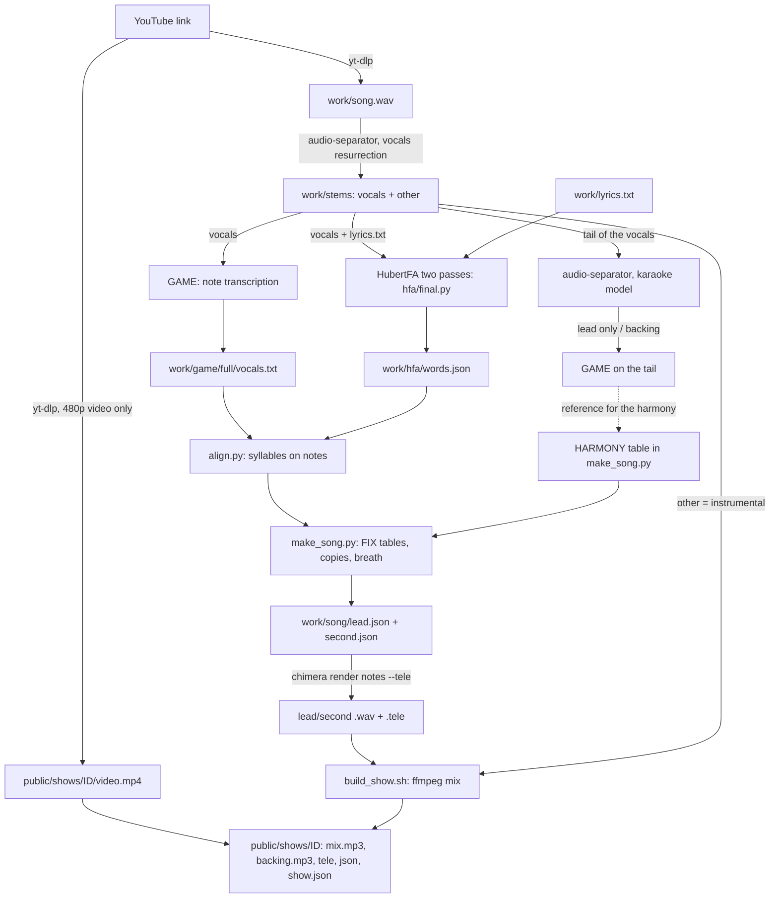

# From a YouTube link to a CHIMERA duet show

This page shows how we made the "Switch Off The Game" cover (the `switch-off` show).
The original is a synth-voice song by Musiclide.
CHIMERA sings both parts: a lead (World Machine) and a second voice (Niko).

You start with a YouTube link.
You end with a folder `public/shows/<id>/` that the duet page opens at `http://127.0.0.1:5317/?show=<id>`.

Run all commands from the repo root, unless the text says otherwise.
Install the tools first: see [setup.md](setup.md).
Python commands use the main Python venv from setup.md.
The command `python` below means that venv's Python.

Do not publish the song, the stems or the video.
They are copyrighted.
The folders `covers/work` and `public/shows/` are gitignored for this reason.

Related pages:
- [sam-singing.md](sam-singing.md): the same workflow with the S.A.M. UTAU voicebank as singer.
- [wireframe-heads.md](wireframe-heads.md): the head looks (`"look": "niko"`).
- [ui-changes.md](ui-changes.md): the changes to the duet page.
- [record-and-host.md](record-and-host.md): record the show to a video and host it.

## The flow



All data stays under `covers/work/` (set `COVERS_WORK` to move it).
Outside tools stay under `covers/vendor/` (set `COVERS_VENDOR` to move them).
Both folders are described in `covers/paths.py`.

The scripts in this area:

| script | what it does |
|--|--|
| `covers/song/hfa/hfa.py` | helpers: cut stem chunks, run HubertFA, read the TextGrids back as words on the song clock |
| `covers/song/hfa/final.py` | the two-pass alignment; writes `work/hfa/words.json` |
| `covers/song/hfa/spot.py` | a check: compares a few word starts with the stem's onsets and loudness |
| `covers/song/align.py` | matches syllables (from the words) to GAME notes, puts them on the grid |
| `covers/song/make_song.py` | builds `lead.json` and `second.json`: the machine result plus hand tables |
| `covers/song/melody.py` | an older, simpler path: GAME notes plus a hand `PLAN.json` of lyrics |
| `covers/song/f0_grid.py`, `second_probe.py` | pitch probes for the notes GAME gets wrong |
| `covers/song/build_show.sh` | renders both voices, mixes, writes `show.json` |

## 1. Download

Make the folders and download the audio.

```bash
mkdir -p covers/work public/shows/switch-off
uvx yt-dlp@latest -x --audio-format wav -o "covers/work/song.%(ext)s" "<YOUTUBE URL>"
```

`uvx` runs the newest yt-dlp without installing it.
YouTube changes often, so an old yt-dlp can fail.
Our `song.wav` is 48 kHz stereo and 256.8 s long.

Download the picture for the corner video: video only, 480p, H.264.

```bash
uvx yt-dlp@latest -f "bv[height<=480][vcodec^=avc1]" \
  -o "public/shows/switch-off/video.mp4" "<YOUTUBE URL>"
```

Why this format:
- The page plays the video on the same clock as the audio, in a small corner window. It has no sound of its own, so we take no audio.
- H.264 plays in every browser. 480p is enough for a corner and keeps the file small (a few MB).
- Check with `ffprobe` that the file is H.264, yuv420p, and that its length matches the audio within a fraction of a second. Ours: 854x480, 24 fps, 256.75 s.

The exact `yt-dlp` options are [reconstructed]: our change log only says "480p, video only". The result (854x480 H.264) is confirmed from the file.

## 2. Separate the voice from the music

```bash
audio-separator covers/work/song.wav \
  -m bs_roformer_vocals_resurrection_unwa.ckpt \
  --model_file_dir covers/vendor/models \
  --output_dir covers/work/stems --output_format WAV
```

With an AMD GPU (setup.md), use the wrapper and the GPU venv instead; it takes the same
arguments and is about 14 times faster:

```bash
LD_LIBRARY_PATH=/opt/rocm/lib covers/vendor/rocm/.venv/bin/python covers/song/separate.py covers/work/song.wav \
  -m bs_roformer_vocals_resurrection_unwa.ckpt --model_file_dir covers/vendor/models \
  --output_dir covers/work/stems --output_format WAV
```

This writes two files into `covers/work/stems/`:
- `song_(vocals)_bs_roformer_vocals_resurrection_unwa.wav`: the voices.
- `song_(other)_bs_roformer_vocals_resurrection_unwa.wav`: everything else. This is the instrumental of the show.

The model files (`.ckpt` and `.yaml`) go into `covers/vendor/models`. See setup.md for the download.
The scripts find the stem with the pattern `work/stems/*(vocals)*`, so do not keep two vocal stems in that folder.

The command line is [reconstructed] from the audio-separator options and the file names that exist. The model name and the output names are confirmed.

Pitfalls:
- On a CPU a whole song takes tens of minutes. It is a one-time cost.
- The vocal stem is not clean. Where two voices sing together (our last chorus), it holds both. Step 3 works around this.
- Use the `other` stem as the instrumental. It keeps the original level of the mix, so the levels in `build_show.sh` fit it. A better instrumental (for example an official instrumental release) works too: set `INST` in `build_show.sh` and match its level.

### Split lead and backing in the tail (only if the song has two singers)

In "Switch Off The Game" the second voice (Niko) comes in at the last chorus.
The vocal stem then holds both voices.
A karaoke model splits the lead from the backing voice.
We cut the stem from 165 s to the end first.

```bash
ffmpeg -y -ss 165 -i "covers/work/stems/song_(vocals)_bs_roformer_vocals_resurrection_unwa.wav" covers/work/tail_vocals.wav
audio-separator covers/work/tail_vocals.wav \
  -m bs_roformer_karaoke_frazer_becruily.ckpt \
  --model_file_dir covers/vendor/models \
  --output_dir covers/work/stems_tail --output_format WAV
```

This gives `tail_vocals_(Vocals)_bs_roformer_karaoke_frazer_becruily.wav` (the lead alone) and `tail_vocals_(Instrumental)_bs_roformer_karaoke_frazer_becruily.wav` (the backing voice, that is Niko, plus remnants).
We copied them to `covers/work/game/tail/leadonly.wav` and `backing.wav` and ran GAME on both (step 3).
The notes in `backing.txt` are relative to 165 s.

The cut point 165 s and the exact commands are [reconstructed]. The two output files and the 165 s offset are confirmed by comparing the audio with the vocal stem.

## 3. Notes with GAME

GAME (openvpi/GAME) turns a singing voice into notes.
It works on a separated stem. It gives floating point pitch values.

```bash
mkdir -p covers/work/game/full
ln -sf "$PWD/covers/work/stems/song_(vocals)_bs_roformer_vocals_resurrection_unwa.wav" covers/work/game/full/vocals.wav
covers/vendor/GAME/.venv/bin/python covers/vendor/GAME/infer.py extract covers/work/game/full \
  -m covers/vendor/GAME/weights/GAME-1.0-medium/model.pt \
  --glob "*.wav" --output-formats mid,txt --pitch-format number
```

The result is `covers/work/game/full/vocals.txt`.
Each row is `onset_s offset_s midi_pitch`, for example `39.360 39.680 53.014`.
`align.py` reads exactly this format. The `number` pitch format matters: the default writes note names.
We used the weights `GAME-1.0-medium`. The weights come from the GAME releases page (see setup.md).

The command line is [reconstructed] from `infer.py extract --help`. The model, the output format and the file names are confirmed.

What to expect and what to fix:
- GAME is good for a synth voice: the original is exact and sits on a grid. For a human voice it gives more slides and slivers. `align.py` drops notes shorter than `MIN_NOTE` (0.09 s).
- GAME also invents notes in speech and under overlaps. Check the result against the song.
- To explore, tune `--seg-threshold` (note boundaries) and `--est-threshold` (note presence).

## 4. Lyrics

Write the sung lines, one per line, in `covers/work/lyrics.txt`.
Our file has 48 sung lines. The last chorus is written out in full.

Rules (see `lab()` in `covers/song/hfa/hfa.py`):
- Write what is sung, not what the lyric sheet says. Write numbers as words.
- Only letters, spaces and apostrophes count. Other marks become spaces.
- The aligner uses an English dictionary. A word that is not in the dictionary (a made-up name) fails or gets wrong times. For the alignment only, write a similar real word (the S.A.M. cover did this with character names). If a word fails, `read()` in `hfa.py` stops with an assertion that names the segment and the word counts.
- `lab()` has one hand fix: `pain's` becomes `pains`. Add yours there.
- Blank lines are ignored, so use them to separate verses.
- The CHIMERA engine uses its own dictionary later, in step 8. A word it does not know stops `render notes` with an error.

## 5. Word times with HubertFA

HubertFA aligns words to the audio (a forced aligner). It works best on short segments (5 to 15 s), but it needs to know where the lines are.
So `hfa/final.py` runs in two passes:

1. Pass 1: coarse regions. You list where the singing is, by hand (voice activity in the stem), and which lyric lines belong to each region. HubertFA aligns each whole region. The times are rough.
2. Pass 2: from the pass 1 word times, the script finds the cut between each two lines (the quietest frame within 0.2 s of the middle of the gap). It joins lines into groups of at least 6 s and aligns each group as its own segment.

It writes `covers/work/hfa/words.json` (every word with its phones, times on the song clock, 1-based line number) and `segments.json`.
It prints, for each segment, how far pass 2 moved the word starts compared with pass 1.
A large number means a bad region. Fix the regions and run again.

Write the regions for your song in `covers/work/hfa/regions.json`:

```json
[["R1", 38.8, 66.4, 0, 8], ["R2", 68.9, 112.9, 8, 24], ["R3", 128.9, 153.6, 24, 32], ["R4", 159.0, 202.3, 32, 48]]
```

Each entry is `[name, start_s, end_s, first_line, last_line + 1]`. The lines are 0-based, in the order of `lyrics.txt`.

Run it with the HubertFA venv Python, not the main venv.
HubertFA needs its own old libraries (`numpy 1.26`, `librosa<0.10`).

```bash
covers/vendor/HubertFA/.venv/bin/python covers/song/hfa/final.py
covers/vendor/HubertFA/.venv/bin/python covers/song/hfa/spot.py   # optional check
```

`hfa.py` starts HubertFA with `taskset -c 0-2` and 3 threads (`run()`), so it does not take the whole CPU. `taskset` exists on Linux only. Change or remove it on other systems.
The model is `models/1218_hfa_model_new_dict/model.onnx` in `covers/vendor/HubertFA` (ONNX build v0.0.7, see setup.md).

`spot.py` prints, for a few words, the start time, the nearest audio onset and the loudness around the start.
Edit its list of `(line, word)` pairs. Use it when a word sounds late or early in the show.

### 5b. Fix the gross errors with Whisper: `fix_words.py`

```bash
python covers/song/fix_words.py
```

HubertFA is exact where it is right. In a busy stem (a choir, ad-libs, a line missing from
`lyrics.txt`) it can hold one word for seconds and push the next words late. `fix_words.py` runs
Whisper (`faster-whisper`, `medium.en`) on the vocal stem once, matches its words to the lyrics in
order, and moves only the words the aligner put more than 0.35 s from Whisper's time. Words
between two matched words that fell outside them follow the earlier one at 0.4 s each.
The aligner's output stays in `hfa/words_aligner.json`; run the script again after each
`final.py` run.

On *You're a Mean One, Mr. Grinch* this moved 30 of 195 words. Before, 22% of the matched words
started more than 0.3 s from Whisper's time and 8% more than 1 s ("everybody" sat 7 s late);
after, 3% and 0%. We also tried Meta's MMS forced aligner (torchaudio `MMS_FA`): on the same song
it had more errors over 1 s (15%) than HubertFA, so we did not keep it.

## 6. Notes to syllables: `align.py`

Run `align.py` alone to see its result for every line:

```bash
python covers/song/align.py covers/work/game/full/vocals.txt covers/work/hfa/words.json
```

Each output line looks like `[2] beat 66.5: a=C4:0.5 shadow.1=A#3:0.5 shadow.2=A3:0.5 ...`.
That is: line number, first beat, then each syllable with its note and its length in beats.
A `?` after a label means the syllable has no note of its own and it split another note. A `-` is a melisma (one syllable held over more notes).

How it works:
- The notes are the truth for time and pitch. The words only say which syllable goes on which note.
- A syllable sits at the onset of its vowel (from the HubertFA phones). `VOWELS` lists the dictionary vowels.
- A dynamic program matches syllables and notes in order. A note without a syllable costs `MELISMA` (0.15 s). A syllable without a note costs `ORPHAN` (0.3 s).
- Times snap to the grid: 96 BPM, sixteenth notes (`GRID` = 0.25 beat), beat 0 at `T0`.
- A silence longer than `REST` (0.2 s) after a note makes a rest (a breath). Otherwise a note lasts until the next one.
- Only the first syllable of a word gets the word as a token. The engine splits the word into syllables itself (its dictionary), so the counts must agree.

For a new song change at the top of `align.py` (and the same three constants at the top of `melody.py`):
- `BPM`: measure it. Use a comb scan over the onset strength of the instrumental. Do not trust `librosa.beat_track` alone: its start-tempo prior can pull the value off (this was seen on the S.A.M. cover's song). Check that the phase stays steady across the whole song.
- `T0`: where beat 0 falls. Ours is 0.0 (the real beats fall at 0.02 s + n x 0.625 s, close enough).
- `GRID`: 0.25 is right for most pop. Use 0.125 for very fast lines.

## 7. Fix the song: `make_song.py`

```bash
python covers/song/make_song.py          # writes covers/work/song/lead.json and second.json
python covers/song/make_song.py --show   # also prints every line (see step 6)
```

The machine result is never perfect.
`make_song.py` holds the hand fixes. Each is a plain table at the top of the file.
Run `--show`, listen or compare with the song, and then edit:

- `FIX = {line_number: line(start_beat, "word:NOTE:len ...")}`: rewrite a line by hand where GAME slipped (a note cut at a line end, two equal notes heard as one, a pickup not heard). In the spec, each item is `token:NOTE[:beats]`. The default length is 0.5 beat. `_` is a further syllable of the word before. `-` is a melisma. We rewrote 13 lines this way, using the verse's own pattern, which every other line confirms.
- The last chorus (lines 41 to 48): there the stem holds two voices and GAME mixes them. So the lead copies the first chorus (lines 17 to 24) 144 beats later (`shifted(lines[ln], 144)`), with the first chorus's words. The second voice sings the same rhythm with its own words, in `CHORUS2`. The syllable counts must match. The code stops with an error if they do not.
- `OUTRO`: start beats of the repeated final line ("so live your life again"). Each copy is the refrain shifted to that beat.
- `held()`: after the second voice comes in, the last note of each refrain is held until the next starts. This copies the original's long note.
- `BREATH`: 0.25 beat is cut from the end of a line's last note when that note is at least one beat long. This gives a breath between lines. `flatten()` also shortens a note that runs into the next line's pickup.
- `HARMONY`: the pitches of the second voice, line by line, as note names. The second voice (Niko) sings the lead's rhythm a harmony above. The pitches come from listening and from the two GAME runs of step 2 and the probes below. `second()` stops with an error if a line has a different number of pitches than notes.
- The line filter `w["line"] <= 40` in `lead()` keeps the lead to lines 1 to 40. Lines 41 to 48 and the outro (49 to 52) are built from copies.

Every line number here is 1-based (the same as in `words.json`).
Do not edit `lead.json` by hand: re-run `make_song.py`.
The file is deterministic. Running it again must give byte-identical files (our md5 sums: `lead.json` `caaf05bb...`, `second.json` `18be3cb1...`).

The melody file format is the CLI's: `{"bpm", "t0", "lyrics", "notes": [[midi, beats], ...]}`.
A note with pitch 0 is a rest. One lyric syllable per sounding note. `t0` is the start of the grid, in seconds.

### Pitch probes

When GAME gives a wrong or missing note, look at the audio yourself:

```bash
python covers/song/f0_grid.py covers/work/game/tail/leadonly.wav 165 264 270
python covers/song/second_probe.py 340 360
```

- `f0_grid.py FILE OFFSET_S BEAT0 BEAT1` prints the median pitch of a single voice per eighth note on the grid. `OFFSET_S` is where the file starts on the song clock (165 for the tail files). `BEAT` is hard-coded to 0.625 s (96 BPM) in the script: change it for a new song.
- `second_probe.py BEAT0 BEAT1` finds, for each eighth note, the pitch that sounds besides the lead (it removes the lead's pitch, its octave and twelfth). It reads the vocal stem and `work/song/lead.json`. This is how we found the harmony pitches under the lead. Its `BEAT` is also hard-coded.

### `melody.py`

`melody.py` is the first, simpler tool. It lists phrases from a GAME file (`phrases`) and builds a melody file from a hand `PLAN.json` that gives the lyrics (`build`). We use `align.py` and `make_song.py` now, but `melody.py` is a good start for a song without usable word times (for example a very fast rap).

```bash
python covers/song/melody.py phrases covers/work/game/full/vocals.txt 38 120
```

## 8. Render with CHIMERA

`build_show.sh` calls the CLI like this. You can run it by hand to test one voice:

```bash
cargo build --release -p chimera-cli     # once
./target/release/chimera render notes covers/work/song/lead.json covers/work/song/lead female \
  --tele covers/work/song/lead.tele --syllables covers/work/song/lead.syl.json
```

Arguments:
- `<in.json>`: the melody file from step 7.
- `<out>`: the output name. The CLI writes `<out>.wav`.
- `[body]`: `male`, `female` or `child`. The body sets the size of the vocal tract, so the timbre. The default is `male`. We use `female` for the lead (it sings G3 to G4) and `child` for Niko.
- `--tele <file>`: writes the voice's whole telemetry over time (the articulators and source). The duet page replays it on a 3D head. The `.wav` and the `.tele` must share sample 0 with the mix.
- `--artic <file>`: writes the articulators over time as JSON (a 2D face).
- `--syllables <file>`: writes every sounding note with its syllable: `[{"t", "dur", "midi", "syl"}]`, in seconds. This flag is new in this fork (`crates/chimera-cli/src/render.rs`). Another singer (the S.A.M. renderer, see [sam-singing.md](sam-singing.md)) reads this file to sing the same syllables on the same beats.

Run the CLI from the repo root: it reads its dictionary from the repo.
`build_show.sh` does `cd "$REPO"` for this reason.
The CLI stops with an error if the number of syllables from the lyrics does not match the number of sounding notes. The message lists the syllables it found, so you can see which word the engine splits differently.

## 9. Mix and write the show: `build_show.sh`

```bash
bash covers/song/build_show.sh
```

With a Python other than `python3` on the PATH, set `PYTHON`:

```bash
PYTHON=path/to/venv/bin/python bash covers/song/build_show.sh
```

The script:
1. Runs `make_song.py` (step 7).
2. Renders the lead and the second voice in parallel (step 8). It writes `lead.tele` and `second.tele` into the show folder and copies the two melody files there (the page writes the words at the mouths from them).
3. Mixes with ffmpeg into two tracks that share sample 0:
   - `mix.mp3`: the two voices (as long as the song). Each voice gets a high-pass filter, a short room echo, a different pan (lead a little left, second a little right) and a gain. The second voice is lower. A silent copy of the instrumental keeps the length. A limiter stops clipping.
   - `backing.mp3`: the instrumental at 0.6. The page gives it a volume slider.
4. Writes `show.json`. Each file address carries the first 8 characters of its md5 hash (`?v=...`). A CDN or a browser then cannot serve an old file under new heads.

Knobs for a new song, all at the top of the script or in the `show.json` block:
- `SHOW` (the show id and folder), `INST` (the instrumental), `LEAD_BODY`, `SECOND_BODY`.
- The ffmpeg filter levels. Our voices are mixed down a little: raise `volume=` if your voices are quiet.
- In `show.json`: `title`, `bpm` and `downbeat` (the heads nod on the beat; `downbeat` is the first beat of a bar, in seconds), the voice `name`s, and `video`.
- `"look": "niko"` on the second voice gives it the Niko wireframe head (see [wireframe-heads.md](wireframe-heads.md)).
- `"enter": 179` keeps the second head off screen until 179 s, so it arrives as a surprise in the last chorus. Remove `enter` if both voices sing from the start.
- A show can also hold `"spell": {"owr": "our"}`: it writes a syllable that you spelled for the dictionary the way it should read on screen.
- The shows `switch-off-v1` and `artist-block` use other singers: see [sam-singing.md](sam-singing.md).

Open `http://127.0.0.1:5317/?show=switch-off` (start the dev server first, see setup.md).
To record the show as a video: [record-and-host.md](record-and-host.md).

## Checklist for a new song

1. Download audio and the 480p video (step 1).
2. Separate the stems (step 2). Split lead and backing in the tail if two singers overlap.
3. Run GAME (step 3).
4. Write `lyrics.txt` (step 4).
5. Measure BPM and T0. Set them in `align.py`, `melody.py`, `f0_grid.py`, `second_probe.py` and `build_show.sh`.
6. Write `covers/work/hfa/regions.json`. Run HubertFA (step 5).
7. Run `align.py`, read the output, and write the `FIX`, `CHORUS2`, `OUTRO` and `HARMONY` tables in `make_song.py` for your lines. Our tables are for our song: delete them first, then add yours. Expect the first runs to stop with an error until the syllable and note counts agree.
8. Pick bodies and run `build_show.sh` (steps 8 and 9).
9. Listen, fix the tables, run again.

## The short way: `cover.py`

For a song with clean lines (no hand tables needed), `covers/song/cover.py` does steps 6 to 9 from
one config file. Keep each song in its own work folder and point `COVERS_WORK` at it:

```bash
COVERS_WORK=covers/work/<song> python covers/song/cover.py --show
```

`<song>/cover.json`:

```json
{"id": "despicable-me", "title": "Despicable Me (Pharrell Williams) - CHIMERA cover", "bpm": 85, "t0": 0.32,
 "voices": [{"name": "Pharrell", "body": "male"}]}
```

Each voice can also have `lines` (1-based inclusive ranges, `[[1, 8], [17, 24]]`), `shift`
(semitones), `gain`, `look` and `enter`. `hand` replaces a line's notes:
`{"12": [[start_s, length_s, "C4", "word"], ...]}`.
It reads `game/vocals.txt`, `hfa/words.json`, `stems/*(vocals)*`, `stems/*(other)*` and
`video.mp4` from the work folder. It drops stray notes after a line's last syllable (ad-libs and
backing voices left in the stem), then writes `public/shows/<id>/`. The voices get the original
vocal stem's loudness.

`mix.mp3` contains only the new voices. The browser adds `backing.mp3` on the same clock.
Do not put the instrumental in both files: that doubles its level and makes the backing
slider unable to mute it.

For half-spoken tracks where GAME misses syllables, set `"notes": "f0"` in `cover.json`.
This takes one pitch per aligned syllable from WORLD's vocal-stem analysis. It folds clear
octave jumps toward the lead's range. This is a heuristic for one lead, not a separator for
overlapping singers. Leave it off for songs with distinct low and high roles.
Set `"grid": 0.125` for a drifting live tempo; timing is rounded to that finer grid.

If HubertFA skips an unknown word, create `hfa/respell.json`, for example
`{"rumba": "rumble", "chicky": "cheeky"}`. Each replacement must be one dictionary word.
Only the alignment spelling changes; CHIMERA still sings the original word.

We made the `despicable-me` show this way. We found its lyrics (the rap verses are missing on most
lyric sites) by running Whisper (`faster-whisper`, model `small.en`) on the vocal stem first.

## Known limits

- `make_song.py` holds facts about Switch Off The Game (line numbers and beat offsets). Its tables need changes for another song. `final.py` reads each song's regions from `hfa/regions.json`.
- GAME and HubertFA work on a single clear voice. They do not work on stacked voices.
- HubertFA needs words that its English dictionary knows.
