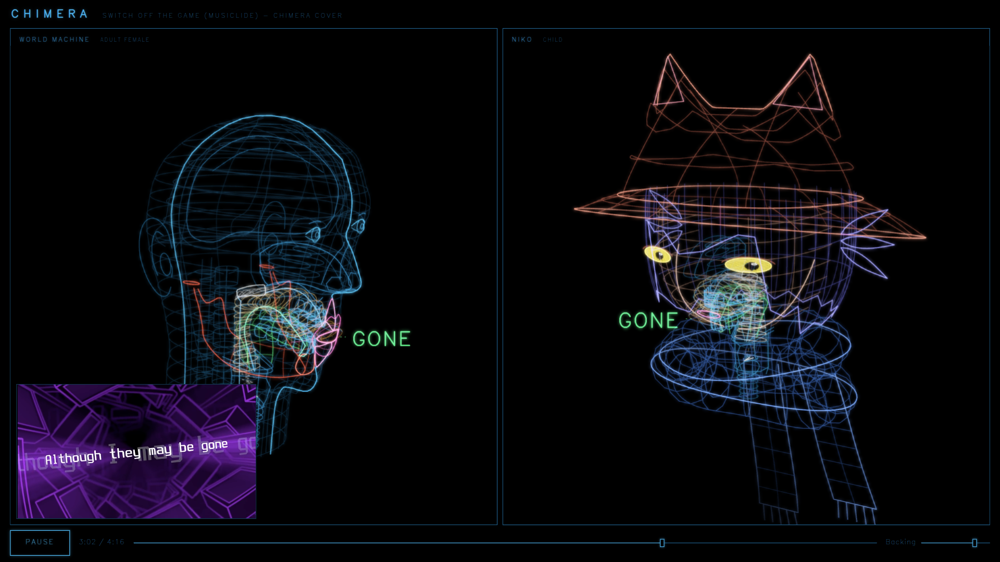
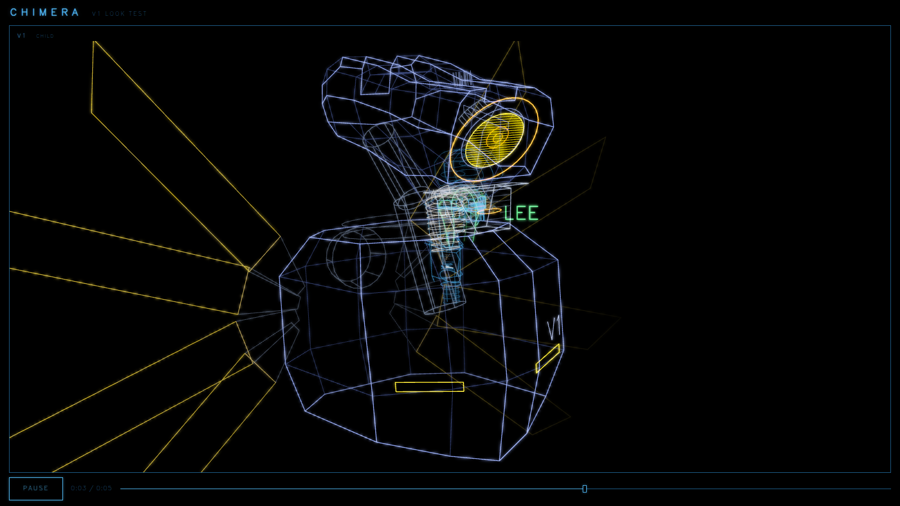
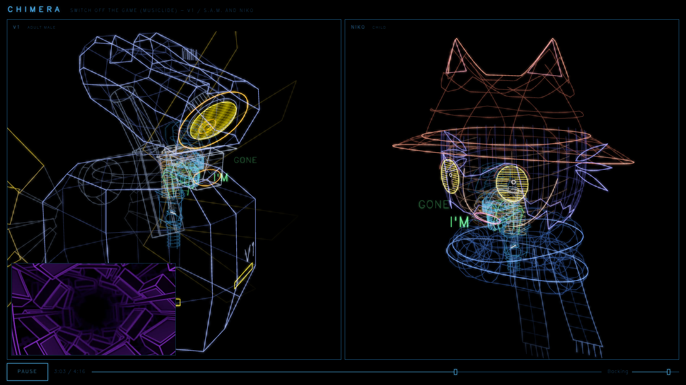

# Wireframe heads (costumes)

In the duet show, each voice is a 3D head drawn as glowing lines. By default it is CHIMERA's own
anatomical head. A **costume** replaces the skull, face and neck with a character. The vocal tract
inside stays the engine's, so the mouth, tongue and throat still move with the real voice.

We made two costumes:

| `look` | Character | Used in |
|---|---|---|
| `niko` | Niko from OneShot: round face, cat eyes, big hat with ears, scarf | `switch-off`, `switch-off-v1` |
| `v1` | V1 from ULTRAKILL: camera-like head, yellow lens, chest plate, wings | `artist-block`, `switch-off-v1` |







This page has two parts. Part 1 explains the code, so you can add your own character. Part 2
explains how we modeled Niko and V1 from reference models. For the rest of the workflow see
[setup.md](setup.md), [ui-changes.md](ui-changes.md) and [record-and-host.md](record-and-host.md).

## Licensing: read this first

We ship no mesh, texture or art of Niko or V1. The costumes are lines that we wrote by hand in
TypeScript. We only used the reference models to measure proportions.

* You must download the reference models yourself.
* You must follow their licenses. Niko's model allows free use and modification if the original
  developer's rights are not infringed (credit to @pungsun3497 is optional). The V1 model on
  GameBanana is CC BY-NC-ND 4.0: do not redistribute it, and do not ship it in your fork.
* Niko is a character of Future Cat Games (OneShot). V1 is a character of Hakita and New Blood
  (ULTRAKILL). Their designs are theirs. Keep fan work non-commercial.
* Keep `covers/work/` out of git. It is already in `.gitignore`.

---

# Part 1: the costume API

## Files

| File | Role |
|---|---|
| `src/ui/render/costume.ts` | The types (`Costume`, `CostumeGroup`, `HeadFrame`, `LiveState`), the `Pen` line builder and small helpers |
| `src/ui/render/niko.ts` | `nikoHead(h: HeadFrame): Costume` |
| `src/ui/render/v1.ts` | `v1Head(h: HeadFrame): Costume` |
| `src/ui/render/anatomy3d.ts` | The `COSTUMES` map, the `Look` type, and every place that reacts to a costume |
| `src/ui/components/AnatomyView3D.tsx`, `DuetPage.tsx` | Pass `voices[i].look` from `show.json` down to the 3D head |

## The coordinate frame

A costume is built once per body, in **the head's frame**, in body centimetres:

* `x` points forward (the face looks along +x).
* `y` points up.
* `z` points to the head's right.
* The glottis is at the origin.

The body is scaled by `k` (a child's body is smaller). Write sizes as a number times `k`. Then
the costume scales with the voice.

## `HeadFrame`: what the costume gets

```ts
interface HeadFrame {
  k: number;                          // the body's scale
  By(Y: number): number;              // template height -> body y
  lip: { x: number; y: number };      // the lips' edge at rest (jaw closed)
}
```

* `By(Y)` converts a height on CHIMERA's head template (in template cm) into body `y`. The template
  has the chin at about 4.4 and the top of the skull at about 23. `niko.ts` uses it for the chin,
  the brow (16.6), the hat (14.6 to 24.4) and the scarf. Use it when you want a part to sit at a
  known place on the template head.
* `lip` is where the mouth is. The costume's face MUST pass through this point, or the mouth floats
  in the air or sinks into the face. Niko fits a ball to it. V1 moves the whole chin so that the
  chin front lands on it.

## `Costume`: what the costume returns

```ts
interface Costume {
  groups: CostumeGroup[];              // static lines, built once
  face: CostumeGroup[];                // the face's lines, redrawn each frame with the mouth cut out
  faceX(y: number, z: number): number; // x of the face surface at (y, z): the mouth is drawn on it
  centerY: number;                     // middle of the whole figure
  halfWidth: number;                   // half-width and half-height, for framing the camera
  halfHeight: number;
  turn: number;                        // the home view's turn from the side view, radians
  mouth?: string;                      // the mouth outline's colour (default: lip pink)
  fogDepth?: number;                   // how far past the centre lines still show (default 30 * k)
  live(s: LiveState): CostumeGroup[];  // moving parts, called every frame
}

interface CostumeGroup {
  lines: Float32Array[];   // each line is x,y,z, x,y,z, ...
  color: string;           // CSS colour
  width: number;
  alpha: number;
  hot?: boolean;           // add a bright core on top of the glow
}
```

Use `new Pen()` to build lines. `pen.path(points, close?)` adds one polyline. A group is one colour,
width and alpha with many lines. Typical use: one bright group for the outline (`width` 1.5 to 1.7,
`alpha` 1, `hot`) and one dim group for the inner mesh (`width` 1.0, `alpha` 0.5).

### `groups` and `face`

* `groups` are static. They are built once and drawn every frame.
* `face` lines are also static, but the engine redraws them every frame and **breaks the line
  wherever the open mouth is**. Only points with `x > 0` (the front) are cut. Put the lines that
  cross the mouth in `face` (Niko's jaw and face grid, V1's chin grid). Do not put a line down the
  middle of Niko's face: it would cross the mouth.

### `faceX(y, z)`

The mouth opening is a patch that the engine draws on your face surface at `faceX(y, z) + 0.05 k`.
Return the real surface x for any (y, z), including the places far from the lips. If it is wrong,
the open mouth hovers over the face or hides behind it. A costume's lips are not ours: the engine
draws only the opening, in `mouth` colour. (V1 uses orange, `#ffa800`, because V1 has no mouth in
the game.)

### `turn`

The home view looks at the head from the side, turned toward the camera by `turn` radians. The
default for our own head is 0.62. Both costumes turn further (Niko 1.0, V1 0.95), to show the
eyes or the lens. A head that faces left gets the mirror view. In a duet, the last head faces left
and the others face right.

### `fogDepth`

The scene has fog. It hides lines that are far behind the head's centre. The default distance is
`30 * k` cm, which is a head's depth. A costume that reaches far behind the head must raise it:
Niko's scarf ends and V1's chest and far wing would fade out. V1 sets `fogDepth: 3.5 * W`
(about 54 cm for `k = 1`). If one side of your costume looks faded in the home view, raise this
number first.

### `centerY`, `halfWidth`, `halfHeight`

The camera distance fits the head template first. Then it grows until the figure fits the pane:
`1.06 * max(halfHeight / half, halfWidth / (half * aspect))`. Set these to the real extent of your
costume (hat tips to scarf ends, wing tips if you want them in frame).

### `live(s)`: the moving parts

Called every frame, after the static lines. `LiveState`:

| Field | Meaning |
|---|---|
| `cam` | The camera, in the head's frame. Use it to fade parts that face away from the camera. |
| `yaw`, `pitch` | Where the eyes look (radians; yaw to the face's right, pitch up) |
| `lid` | Eyelids: 0 open to 1 shut. Use a minimum opening (0.05) so the eye never vanishes. |
| `wide` | Eyes widened, 0 to 1 |
| `level` | The voice's output level (RMS) |

Both costumes use `cam` to fade out an eye or the lens when it faces away from the camera (else a
disc seen from behind shows through the head). Use `smooth(a, b, x)` from `costume.ts` for the
fade. Niko draws each eye as a yellow disc with fill strokes that leave the pupil dark. V1 draws a
shutter lens: its fill strokes narrow with `lid`, the iris follows the gaze, and the lens and the
two chest slits get brighter with `level`.

## How the engine uses a costume (`anatomy3d.ts`)

All of this is in `git diff src/ui/render/anatomy3d.ts`.

1. `COSTUMES` maps a name to a builder. `Look` is `keyof typeof COSTUMES`. The `satisfies` clause
   checks that each builder has the signature `(h: HeadFrame) => Costume`.
2. `buildRest(model, look)` builds the static head. With a `look`, it drops our bones, brain, nose,
   ears and skull shell (`bones`, `jawBones` become empty), and the lip lines.
3. It then calls `COSTUMES[look]({ k, By, lip })` with the closed-jaw lip position, pushes
   `costume.groups` into the fixed lines, and moves the camera target to `costume.centerY`.
4. Each frame, `costumeFace` draws `face` with the mouth cut out, and `costumeLive` draws
   `live()`.
5. The mouth patch is drawn on `faceX` in `costume.mouth` colour.
6. `poses()` uses `halfWidth`, `halfHeight` and `turn` for the camera. `fogDepth` sets the fog's
   far plane.

## Add a new costume

1. Create `src/ui/render/mychar.ts`. Start from `niko.ts` (smooth shapes) or `v1.ts` (hard
   shapes). Export `mycharHead(h: HeadFrame): Costume`.
2. Register it in `src/ui/render/anatomy3d.ts`:

   ```ts
   import { mycharHead } from "./mychar.ts";
   const COSTUMES = { niko: nikoHead, v1: v1Head, mychar: mycharHead } satisfies Record<string, (h: HeadFrame) => Costume>;
   ```

   The `Look` type updates by itself.
3. Use it in a show. In `public/shows/<id>/show.json`, add `look` to a voice:

   ```json
   { "name": "My character", "tele": "lead.tele", "melody": "lead.json", "look": "mychar" }
   ```

   There is no check for a wrong name. A typo throws when the head is built.
4. Open `http://127.0.0.1:5317/?show=<id>` and check these things, in this order:
   * Does the mouth open on the face? If not, fix `faceX` and the `lip` fit.
   * Is any part faded in the home view? Raise `fogDepth`.
   * Is the figure cut off? Fix `centerY`, `halfWidth`, `halfHeight`.
   * Do you see the front? Fix `turn`.
   * Do the eyes show through from behind? Add a `cam` fade.
5. For a quick preview, make a short test show from a copy of an existing one. The screenshot
   script in [record-and-host.md](record-and-host.md) takes a frame at any time of a show.

### Hints from our work

* Build the lines from a few clean functions (`on(ball, y, theta)` for Niko's face, `RINGS` for
  V1's head). Then proportions are numbers you can change in one place.
* Colours must be bright. Lines are beams on black. A dark steel colour like `#0c0f12` vanishes.
  We used `#6a7a96` for V1's steel.
* Keep `live()` cheap. It runs every frame for every voice.
* `hot: true` makes a line read as lit. Save it for outlines and for lights.

---

# Part 2: how we modeled Niko and V1

The method is the same for both:

1. Get a 3D model of the character, only as a measuring reference.
2. Read the mesh in a script. Print sizes by height band and by part.
3. Turn the sizes into ratios of the head's width (or height). Ratios transfer to any head size.
4. Write the costume by hand with those ratios. Check it against renders of the reference.

Raw numbers, tables, palettes and the web art we used live in `covers/work/niko-ref/brief.md` and
`covers/work/v1-ref/brief.md`. These briefs are local files. They are not in git.

## Reference data layout

All reference data stays under `WORK` (`covers/work/` by default, see [setup.md](setup.md)):

```
work/niko-ref/
  model/Niko (Oneshot) 3D Model v6.0.3/Niko(Oneshot).blend   <- you download this
  .venv/                                                       <- Python with Blender's bpy
  render/                                                      <- the Niko scripts write here
work/v1-ref/
  model/gb5430/v1_v2_255/v1_v2_/v1_v2.an8                      <- you download this
  model/gb5430/v1_v2_255/v1_v2_/textures/v1/*.png
  render/                                                      <- the V1 scripts write here
  head_vertices.json                                           <- written by dump.py
```

## Niko

### Reference

A fan 3D model of Niko by pungsun3497, version 6.0.3, a `.blend` file. Its author allows free
use and modification (see the licensing section). The author announced the release in the OneShot
community, for example in
[this r/oneshot thread](https://www.reddit.com/r/oneshot/comments/1irgzoh/niko_3d_model_released/).
We downloaded it from a link there. Follow the link in the post. [Not re-checked: the link we
used is not in our notes, so look for the current one.]

Unpack it to `covers/work/niko-ref/model/` so that the `.blend` is at the path above. If your
folder name differs, edit the `.blend` path at the top of each script in `covers/heads/niko/`.

### Python with Blender

The `.blend` is read with `bpy`, the Blender module for Python. We used a separate environment,
because `bpy` is large and needs a Python version that matches its wheel:

```sh
cd covers/work/niko-ref
uv venv -p 3.13 .venv
uv pip install --python .venv/bin/python bpy        # we had bpy 5.3.0 on Python 3.13.12
cd ../../..
```

### Scripts (`covers/heads/niko/`)

Run them from the repo root with that Python. They load the `.blend` and print numbers or write
renders. They never modify the `.blend`.

```sh
NB=covers/work/niko-ref/.venv/bin/python
$NB covers/heads/niko/insp_blend.py      # list every object: type, parent, vertex count, bounding box
$NB covers/heads/niko/measure.py         # head materials, hat profile by height, brim, hair, scarf, bones
$NB covers/heads/niko/ears.py            # the hat's ears, by height
$NB covers/heads/niko/render_views.py    # head views and full body to work/niko-ref/render/
$NB covers/heads/niko/render_close.py    # close-ups, hat on and off, to work/niko-ref/render/
```

Blender prints many "Invalid driver" warnings about the skirt bones. They are harmless. The two
render scripts use the fast Workbench engine with flat texture colours and an orthographic
camera. An engine name as the last argument (`BLENDER_EEVEE`, `CYCLES`) overrides it.

Two details that matter:

* The scripts use the **evaluated** mesh (`evaluated_get` on the depsgraph). The raw mesh differs
  from what you see, because modifiers and the armature pose change it.
* The model's frame is metres, Z up, and the face looks toward -Y.

### What we measured

Niko's head is 0.2198 m wide (W), 0.2207 m deep and 0.2895 m tall (H = 1.32 W). That is close to
the app's head (19.6 by 15.3 cm, ratio 1.28), so ratios transfer directly. We use `u`, the height
above the chin as a fraction of H.

| Part | Result | In the code |
|---|---|---|
| Hat brim | 2.5 W across, nearly flat, tipped back about 11 degrees (front up, back down to ear level) | `brim()`, `baseY`, `edgeY` |
| Hat crown | Sides almost vertical; front and back slope in to a left-right ridge | `crown()`, `RIDGE` |
| Ears | Triangles on the ridge's two ends, tips 0.245 H above the skull top | `earRise()`, `EAR` |
| Eyes | 0.27 W either side of the middle, at `u = 0.42` (low: it is chibi), 0.29 W wide | `eyes`, `eyeY`, `eyeR` |
| Hair | A bob to the chin; a fringe to the eye tops; three leaf tufts each side at eye height | `strands`, `strandEnd()`, tufts |
| Scarf | Bulky, up to chin level, two ends down the back | `LOOPS`, `tail()` |

### How the costume is drawn (`niko.ts`)

* **Face.** A superellipse ball (exponent `E = 2.5`: a bit fuller than an ellipsoid) from the chin
  to the top of the head, as wide as our head. The code solves `face.rx` so that the ball's front
  passes through `h.lip`. `faceX` returns the same surface. The face lines go in `face`, so the
  mouth is cut out of them.
* **Eyes.** Two discs on the face, turned between "straight ahead" and "straight out of the face".
  Drawn in `live()`.
* **Hat.** Brim rings and spokes, a crown base ring, crown rings up to the ridge, the ears in
  salmon outline with a pink inner triangle.
* **Hair.** 36 strands on a ball slightly larger than the face. `strandEnd()` sets where each
  strand stops: fringe, cheek locks, then the hem of the bob. The hat hides the top.
* **Scarf.** Two tube loops round the neck and two ends that sway a little.

Pitfalls we hit:

* The model's scarf wrap reaches chin level. That hides the larynx and the tract. Our wraps sit
  below the jaw.
* The ears are a little taller than the model's, because the game art draws them taller. This is
  a deliberate change.
* The model's eyes use a yellow ring with a dark red pupil. We draw a dark tall pupil by leaving a
  gap in the fill strokes. Lines cannot paint a dark disc.

### Palette

We took game sprite and 3D render colours, then made them bright enough for beams (`NIKO` in
`niko.ts`): hat `#d2664a`, hat shadow `#9e5040`, ear inside `#ff9db0`, hair `#6f6ff0`, scarf
`#4a86ff`, eye `#ffe94d`, pupil `#ff7a3a`, skin `#d9a48a`.

## V1

### Reference

"V1&V2 Ultrakill anim8or rigged" by borbabcd, GameBanana model 5430:
<https://gamebanana.com/models/5430>, file `v1_v2_260.zip` (we used the direct link
`https://gamebanana.com/dl/1641317`). The license is **CC BY-NC-ND 4.0**. We use it only to
measure. It is never shipped, and nothing derived from it is a mesh. Hakita and New Blood own
V1's design.

The file is a rig of the game's own mesh: the body has 1434 points and 1556 faces, and with the
8 wing blades (144 faces each) there are 2708 faces. That is the "Tricount 2708" of the official
wiki render, so it is the real in-game V1.

Unpack it to `covers/work/v1-ref/model/gb5430/`, so that this file exists:
`covers/work/v1-ref/model/gb5430/v1_v2_255/v1_v2_/v1_v2.an8` (with `textures/v1/` next to it). If
your folder names differ, change `PACK` at the top of `covers/heads/v1/an8.py`. The other V1
scripts read their paths from there.

### Reading an `.an8` file

Anim8or's `.an8` is a **text** format, so no Blender is needed. `an8.py` parses the meshes of one
object (`v1-ultrakill` or `feedbacker`) with regular expressions: points, texture coordinates and
faces with their per-corner texture indices.

The file stores the body turned 180 degrees about Y. After loading, we flip `x` and `z`. Then:

* units are metres, feet at `y = 0`, total height 1.598 m (9.35 head widths);
* the front of V1 is +z, and a viewer at +z sees +x on the right;
* +x is V1's left (the barcode side).

### Segmenting the mesh

The body is one mesh. We need the head alone. `segment.py` welds vertices that sit at the same
place (rounded to 0.1 mm) and finds the **connected components** of the face graph with SciPy.
It sorts them by top height. The first ones are:

| Component | What |
|---|---|
| 0 | Head shell (98 vertices) |
| 1 | Rear neck piece |
| 2 | Neck rod |
| 3 | Torso core |
| 4 | Round knob on the upper back |
| 5 | Upper arm (and more, then the legs) |

`parts_render.py` colours components by role (head yellow, neck green, chest blue, arm pink) so you
can check the split by eye.

### Scripts (`covers/heads/v1/`)

They need only numpy, SciPy and Pillow. Run them from the repo root with the main Python:

```sh
PY=.venv/bin/python
$PY covers/heads/v1/segment.py        # list the components with their bounding boxes
$PY covers/heads/v1/measure.py        # head box, lens, head pitch, y-band profile of the head
$PY covers/heads/v1/dump.py           # head height bands in head widths; writes work/v1-ref/head_vertices.json
$PY covers/heads/v1/profile.py        # torso, shoulders, back knob and neck rod measurements
$PY covers/heads/v1/yellow.py         # which faces are yellow in the texture (lens, chest lights)
$PY covers/heads/v1/make_renders.py   # head, upper body and full body views to work/v1-ref/render/
$PY covers/heads/v1/parts_render.py   # the colour-coded parts, to work/v1-ref/render/
```

`render.py` is the renderer they share. It is a small software renderer (Pillow, no GPU). It makes
an orthographic view, culls back faces, colours each triangle from the texture at its centre,
and can draw only the edges. Use `*wire*` renders to judge the line look.

The texture is only 256 pixels, and samples at triangle centres are noisy. Use our palette, not
the sampled colours.

### What we measured

`W` = the head's width, 0.171 m. Everything below is in W unless noted.

| Part | Result |
|---|---|
| Head, bounding box | 1 W wide, 1.19 W tall, 1.68 W deep (a long wedge, like a camera) |
| Head pitch | The long axis tilts about 5.6 degrees nose-down; the top plate rises toward the back |
| Head cross-section | Widest at about 70 % height; 0.55 to 0.65 W at the top; two rails on top with a slot between |
| Lens | A disc 0.4 to 0.5 W wide, on the front, facing forward and about 45 degrees down (the average face normal gave 44 degrees; the code uses 0.65 rad, 37 degrees) |
| Chin plate | 0.45 to 0.8 W wide, narrows downward, 0.47 W tall. It is the only part that can act as a mouth |
| Neck | Two bent rods, 0.29 and 0.25 W thick, leaning back 20 and 38 degrees. The head hangs forward of the neck |
| Back knob | A dome 0.47 W wide on the upper back |
| Chest | 1.63 W wide, 1.87 W deep; the armour plate is 1.3 W tall; the front is two plates with a ridge and a V along the lower edge |
| Chest lights | Two slits, about 0.5 W from the middle, low on the front. They are **texture only** in the mesh, so we found them by sampling the texture (`yellow.py`) |
| Wings | Four blades each side, behind the shoulder blades, about 4 W long, at about +50, +20, -17 and -40 degrees from level |

### The head `RINGS`

The head is the hardest part, because it is not a box. We cut it into six vertical slices from
back to front, and read each slice's outline off the mesh. Each slice (a "ring") is the right
half of the outline, nine points `[u, v, w]` in W units, with the head's front-top corner as the
origin: `u` forward (negative is behind), `v` up, `w` to the right.

The nine points of a ring are, in this order:

| Index | Point |
|---|---|
| 0 | Floor of the top slot, on the midline |
| 1 | Corner of the slot |
| 2, 3 | Top of the rail, inner and outer |
| 4 | Top's outer edge |
| 5 | Widest point |
| 6 | Foot of the side |
| 7, 8 | Underside, out and on the midline |

`v1.ts` mirrors each half to make a closed loop (`loop()`), draws every ring, and joins the
vertices along the head (`along()`). The `EDGES` list (2, 3, 5, 6) names the long edges drawn
bright. The last ring is the front's rim, a hood over the lens. Behind the hood, the lens sits
back in an octagonal housing.

[Reconstructed: the scripts print bands and bounding boxes, but no script writes `RINGS`. We
read the slices from the printed bands and from the renders, and wrote the numbers by hand. To
redo this for another model, print bands with `dump.py` and `measure.py`, then check each ring
against a `headwire_*` render.]

To change the head's shape, edit `RINGS` in `v1.ts`. Each number is in head widths.

### How the costume is drawn (`v1.ts`)

* **Head.** The rings above. On the left side: a barcode and a long slot, as on the real head.
* **Lens.** An octagonal housing, a recess on the midline, and the lens disc. `live()` draws the
  glass: filled strokes that close like a shutter with `lid`, an iris that follows the gaze, and
  a ring that grows and glows with the voice level. It fades when the camera is behind.
* **Chin.** A block under the lens, with a plate that juts out on each side. Its front lines are in
  `face`, so the mouth is cut out of them. The whole head is shifted so the chin front sits at
  `h.lip` (`LIP_U`, `LIP_V`).
* **Neck and back.** Two six-sided tubes, and the knob (a short drum).
* **Chest.** Four levels of rings (`LEVELS`: height, half-width, front and back), joined by edges
  and a ridge. The bottom ring has a V. Two light slits and the letters "V1" on the left plate.
* **Wings.** See the next section.

V1 has no mouth and no voice in the game. Fan content uses the S.A.M. speech synthesizer as its
voice. So the mouth opening appears on the chin plate, in orange, and the lens and the slits
brighten with the voice. [INFERENCE: the mapping of the jaw to the chin plate and of the level to
the lens is our own design choice (`covers/work/v1-ref/brief.md` marks it so), not something from
the game or from fan videos.]

### Wings at 60 %

`const WING = 0.6`. The wings are drawn at 60 % of the game's size. The comment in the code says
why: at that size the near side's blades stay mostly inside the close three-quarter view. At full
size they probably run out of the frame [not tried]. To try the full size, set `WING = 1` and
raise `halfWidth` in the returned costume (and check `fogDepth`).

Each blade has a short dark root and a long yellow blade with a slanted tip (the upper edge
runs further than the lower). The angles `[50, 20, -17, -40]` and the lengths `[3.9, 4.4, 4.4,
3.9]` (in W, before `WING`) come from the mesh's blade tips.

### What we left out, and why

The model has shoulders, upper arms, forearms (Feedbacker on the left), hands, an abdomen, a pelvis
and legs. We draw none of them. The costume ends at the bottom of the chest plate. The comment at
the top of `v1.ts` still lists "shoulders and upper arms", but the code draws none.

* **Arms and shoulders.** [INFERENCE: not stated in our notes. Reconstructed from the code.] The
  frame (`centerY`, `halfHeight`) ends below the chest. The view is a close head and chest. Arms
  would add lines that cross the chest and the wings, and the pane is already full of lines.
  Our measurements are in the table in `covers/work/v1-ref/brief.md` if you want to add them
  (a 0.6 W shoulder pad at about 1.4 W from the middle, and a 1.75 W upper arm).
* **Abdomen, pelvis, legs.** They lie outside the frame, and the face and the throat are what the
  viewer looks at.

### Palette

`V1` in `v1.ts`: armour `#5f78d6`, armour highlight `#8fa5e8`, steel `#6a7a96` (brighter than the
game's `#3a4658` so it reads on black), lens `#ffe600`, glow `#ffa800`, wings `#ffd000`, cables
`#e0303a`. The game's own darkest colours are nearly black and would vanish as beams.

---

## Dependencies for this area

| Need | Version we used | For |
|---|---|---|
| Python 3 with `numpy`, `scipy`, `Pillow` | the main venv ([setup.md](setup.md)) | all `covers/heads/v1/` scripts |
| Python 3.13 venv with `bpy` | `bpy` 5.3.0 on Python 3.13.12, in `covers/work/niko-ref/.venv` | all `covers/heads/niko/` scripts |
| Niko model, `Niko(Oneshot).blend` v6.0.3 by pungsun3497 | | Niko measuring, local only |
| V1 model, GameBanana 5430 `v1_v2_260.zip` by borbabcd | | V1 measuring, local only, CC BY-NC-ND |
| Bun and the dev server | see [setup.md](setup.md) | previewing costumes |

The costumes themselves (`niko.ts`, `v1.ts`) need none of these. A fork that only wants to **use**
the two costumes needs no reference model at all.
